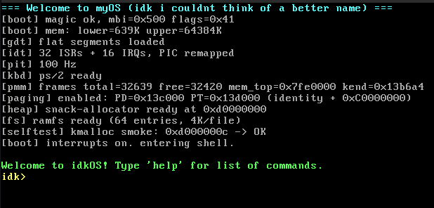

# idkOS 

A 32-bit x86 OS using an interactive `idk>` shell.



Written mostly in C


## How to run

```bash
git clone https://github.com/arsenal4eva/myOS
make            
make grub-check 
make qemu       
```

Debug: `make qemu-debug` + `gdb -ex 'target remote :1234' idkos.bin`.


## Commands list

help | sysinfo | man | echo <text> | clear | ticks | beep |
create <file...> | mkdir <dir...> | list [path...] | print <file...> | remove <path...> | edit <file...> | type <file...> |


Files live in a RAM filesystem (64 entries, 4 KiB/file, `a/b.txt` paths OK).
Redirection: `echo hello > hi.txt`, `echo more >> hi.txt`, `print < hi.txt`
(any command's output redirects, e.g. `sysinfo > info.txt`).
Globbing: `*` any run, `?` one char — `list *.txt`, `print docs/*.txt`;
quote to suppress (`echo "*"`).
Chaining: `;` runs commands in order — `echo hi ; ticks`;
`;` inside quotes or escaped as `\;` stays literal.
Try: `create hi.txt`, `echo hello > hi.txt`,
`print hi.txt`, `list *.txt`.
Chained: `create hi.txt ; echo hello > hi.txt ; print hi.txt ; list *.txt`.

## AI was used

I tried to keep AI usage to a minimum, eg. debugging, translating
AI was also used to fix commit and pushing conflicts
